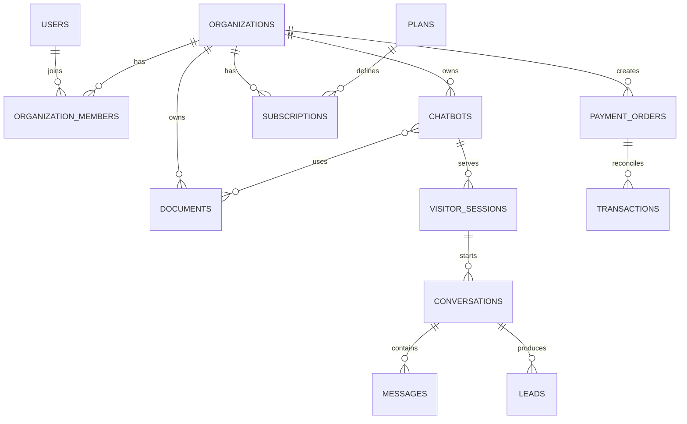

# Database

PostgreSQL là database production. Mọi bảng nghiệp vụ chứa `organization_id` hoặc có quan hệ sở hữu tương đương; API không tin tenant do frontend gửi nếu membership không hợp lệ.

Schema còn có `document_chunks`, `usage_logs`, `quota_logs`, `notification_logs` và `audit_logs`. `(provider, provider_transaction_id)` là unique constraint chống replay thanh toán; `(source_message_id)` chống tạo lead trùng từ một message.

Migration hiện tại nằm tại `backend/alembic/versions`. Không dùng `create_all` ở runtime production.
