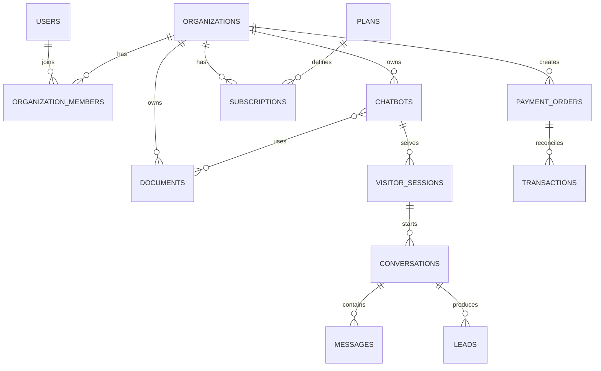

# Database

MongoDB Atlas là database production. Mỗi loại bản ghi nằm trong một collection; dữ liệu tenant chứa `organization_id` hoặc có quan hệ sở hữu tương đương. API luôn xác minh membership, không tin tenant do frontend gửi.

Schema còn có `document_chunks`, `usage_logs`, `quota_logs`, `notification_logs` và `audit_logs`. `(provider, provider_transaction_id)` là unique constraint chống replay thanh toán; `(source_message_id)` chống tạo lead trùng từ một message.

Index được khai báo trong `backend/app/core/mongodb.py` và được kiểm tra khi ứng dụng khởi động. Script `deployment/migrate-sqlite-to-mongodb.py` dùng để nhập dữ liệu SQLite cũ theo kiểu idempotent; SQLite chỉ được giữ làm bản rollback lịch sử.
